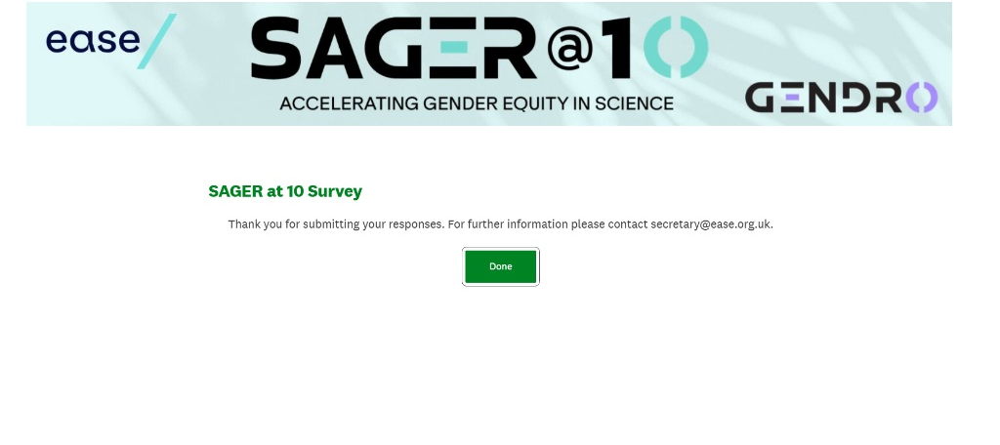

# Asia Book of Records — Grandmaster Certification & Open Science Archive

## Official Recognition & Certification

* **Title Awarded:** Grand Master
* **Awarding Body:** Asia Book of Records (affiliated with World Record University; Registered with Govt. of India, RNI No. HARENG/2011/40693)
* **Recipient:** Kallol Chakrabarti (Unaffiliated Independent Researcher, Uttar Pradesh, India)
* **Citation:** Publishing **158 DOI (Digital Object Identifier) research papers** across open-access platforms—including Zenodo, DeSci Labs, and SSRN—within a single calendar year (January 1, 2025 – December 31, 2025)
* **Confirmation Date:** October 14, 2026
* **Certificate Issue Date:** November 5, 2026

---

## National Record Verification
* **India Book of Records Record Holder:** Verified national-level archival record establishing high-volume independent open-science scholarship without institutional funding or backing.
* **Portal Archive:** [Explore India Book of Records Repository](https://helixoriginator.github.io/Kallol-Chakrabarti-India-Book-of-Records-Holder/)

---

## Global Open Science & Policy Consultations

### EASE & GENDRO — SAGER@10 Global Consultation (November 12, 2026)
Participated as an **Unaffiliated Independent Researcher & Open Peer Reviewer** in the 10-year review of the Sex and Gender Equity in Research (SAGER) guidelines organized by the European Association of Science Editors (EASE) and GENDRO.

* **Core Advocacy:** Promoting gender balance among peer reviewers, expanding open peer review networks beyond traditional academic silos, and establishing plain-language summaries and research-to-community feedback loops to make scientific knowledge accessible to the masses.

---

## Researcher Identifiers & Digital Footprint
* **ORCID Profile:** [0009-0007-4971-8936](https://orcid.org/0009-0007-4971-8936)
* **SSRN Author ID:** 7407085 (Top 3% Global Author Rank)
* **ScienceOpen Peer Reviewer:** Global Editorial & Peer Review Division
